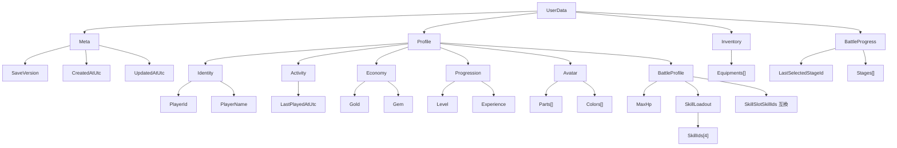

# UserData 構造

`UserData` はゲーム内の主軸モデルであり、そのまま JSON 保存される永続データでもある。

## 構造ツリー

## 補足

- `Meta` は保存ファイル自体の情報を持つ。
- `Profile` はプレイヤー本人に属する長期保持情報をまとめる。
- `BattleProfile` は現行コード上では `Profile` 直下の `MaxHp`、`SkillLoadout`、互換用 `SkillSlotSkillIds` として保持する。
- 実戦用 Skill パレットは `SkillLoadout.SkillIds` を正とし、4 枠固定で保存する。
- `SkillSlotSkillIds` は旧保存データ互換用に残し、保存正規化時に `SkillLoadout.SkillIds` と同期する。
- `Inventory` と `BattleProgress` は機能単位で独立したデータ群として `UserData` 直下に置く。
- バトル中 HP やターン数のような一時状態は `UserData` に入れず、引き続き実行時状態側で扱う。
