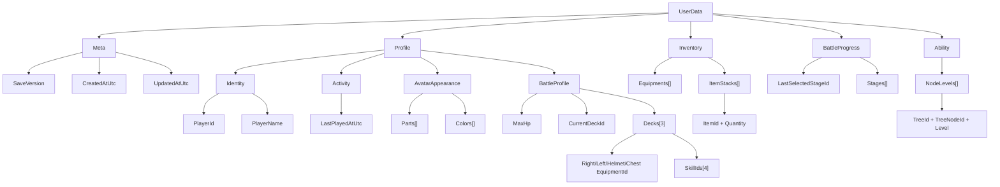

# UserData 構造

`UserData` はゲーム内の主軸モデルであり、そのまま JSON 保存される永続データでもある。

## 構造ツリー

## 補足

- `Meta` は保存ファイル自体の情報を持つ。
- `Profile` はプレイヤー本人に属する長期保持情報をまとめる。Level / Experience は採用しない。
- `BattleProfile` は `Profile` 直下の `MaxHp`、`CurrentDeckId`、`Decks` として保持する。
- `AvatarAppearance` は髪、目、ひげ、色などの見た目専用データであり、戦闘装備は含めない。
- 実戦用の右手・左手・兜・胴とSkill4枠は `Decks` を正とし、`CurrentDeckId` のデッキを現在構成として扱う。
- 旧保存データにある `Profile.Gold` と `Ability.PointBalance` は、読み込み時に対応する `ItemStacks` へ移行する。未使用の `Gem` は読み込み時に破棄する。
- JSON 読み込み時は、モデルの初期値リストへ追記せず、保存済み JSON のオブジェクトと配列で置き換える。これにより再起動時にデモ初期値が保存済み Skill ロードアウトより優先されないようにする。
- `Inventory` と `BattleProgress` は機能単位で独立したデータ群として `UserData` 直下に置く。`ItemStacks` は Gold、Ability Point、素材、チケットなど数量を持つ共通所持品の正本とする。Items ダイアログの表示名、説明、アイコン、所持数0時の表示、所持数表示は `ItemMasterData` で定義する。
- DebugSheet の `Player Data` ページでは Gold と Ability Point の所持数を直接上書きできる。0を指定したアイテムは `ItemStacks` から削除する。`Equipment` ページでは全装備の所持状態を個別Switchで直接切り替えられ、`Reset Owned Equipment` で `Inventory.Equipments` を空にできる。いずれも即時保存する。空にしても、次回初期化時には `IsDefaultOwned` の装備が再付与される。
- 旧 Event Mission 用の ItemId `2000` / `3000` はキー廃止に伴い、読込時に `ItemStacks` から削除する。
- `Ability` は購入済み配置NodeのLevelだけを持つ。Ability Point は `ItemStacks` の ItemId で管理する。`NodeLevels` のキーは必ず `TreeId + TreeNodeId` とし、Level 0、解放状態、能力補正、排他状態は保存しない。詳細は `docs/specs/Ability仕様書.md` を正とする。
- バトル中 HP やターン数のような一時状態は `UserData` に入れず、引き続き実行時状態側で扱う。

## 今後追加する周回・物語進捗

- `The Remnant`の獲得済み状態と、`Resurgence`開始可否を保存する。
- 周回ごとに、人間ボスの通常撃破／救済結果、解放済み`Insights`、追加済み安全地帯数、上位存在到達済み状態を保存する。現在は `UserData.Cycle` に `IsResurgence`、`HasReachedHigherBeing`、ボスごとの `StageId` / `BossResolution` / Insight既読状態を保存する。Insight解放状態は `BossResolution` から導出する。Resurgence開始時はこれらをリセットする。
- 装備、Skill、Trait進捗、Armoryで解放済みの商品一覧はResurgence開始時にも保持する。
- Missionのクリア進捗とPoint / Gold受領状態はResurgenceでリセットし、同Missionの再クリアによる再取得を許可する。

旧 `Avatar.Parts` と単一 `SkillLoadout` を正本とする保存形式との互換は提供しない。詳細は `docs/specs/デッキ仕様書.md` を正とする。
