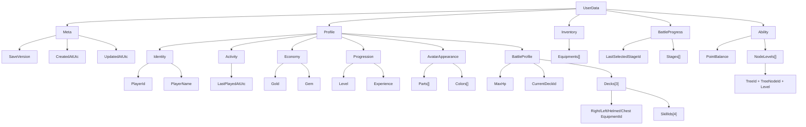

# UserData 構造

`UserData` はゲーム内の主軸モデルであり、そのまま JSON 保存される永続データでもある。

## 構造ツリー

## 補足

- `Meta` は保存ファイル自体の情報を持つ。
- `Profile` はプレイヤー本人に属する長期保持情報をまとめる。
- `BattleProfile` は `Profile` 直下の `MaxHp`、`CurrentDeckId`、`Decks` として保持する。
- `AvatarAppearance` は髪、目、ひげ、色などの見た目専用データであり、戦闘装備は含めない。
- 実戦用の右手・左手・兜・胴とSkill4枠は `Decks` を正とし、`CurrentDeckId` のデッキを現在構成として扱う。
- 旧保存データの変換は行わず、現行の `UserData` JSON 形式だけを受け入れる。
- JSON 読み込み時は、モデルの初期値リストへ追記せず、保存済み JSON のオブジェクトと配列で置き換える。これにより再起動時にデモ初期値が保存済み Skill ロードアウトより優先されないようにする。
- `Inventory` と `BattleProgress` は機能単位で独立したデータ群として `UserData` 直下に置く。
- `Ability` はPoint残高と購入済み配置NodeのLevelだけを持つ。`NodeLevels` のキーは必ず `TreeId + TreeNodeId` とし、Level 0、解放状態、能力補正、排他状態は保存しない。詳細は `docs/specs/Ability仕様書.md` を正とする。
- バトル中 HP やターン数のような一時状態は `UserData` に入れず、引き続き実行時状態側で扱う。

旧 `Avatar.Parts` と単一 `SkillLoadout` を正本とする保存形式との互換は提供しない。詳細は `docs/specs/デッキ仕様書.md` を正とする。
