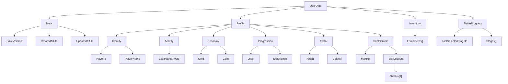

# UserData 構造

`UserData` はゲーム内の主軸モデルであり、そのまま JSON 保存される永続データでもある。

## 構造ツリー

## 補足

- `Meta` は保存ファイル自体の情報を持つ。
- `Profile` はプレイヤー本人に属する長期保持情報をまとめる。
- `BattleProfile` は現行コード上では `Profile` 直下の `MaxHp` と `SkillLoadout` として保持する。
- 実戦用 Skill パレットは `SkillLoadout.SkillIds` を正とし、4 枠固定で保存する。
- 旧保存データの変換は行わず、現行の `UserData` JSON 形式だけを受け入れる。
- JSON 読み込み時は、モデルの初期値リストへ追記せず、保存済み JSON のオブジェクトと配列で置き換える。これにより再起動時にデモ初期値が保存済み Skill ロードアウトより優先されないようにする。
- `Inventory` と `BattleProgress` は機能単位で独立したデータ群として `UserData` 直下に置く。
- バトル中 HP やターン数のような一時状態は `UserData` に入れず、引き続き実行時状態側で扱う。
