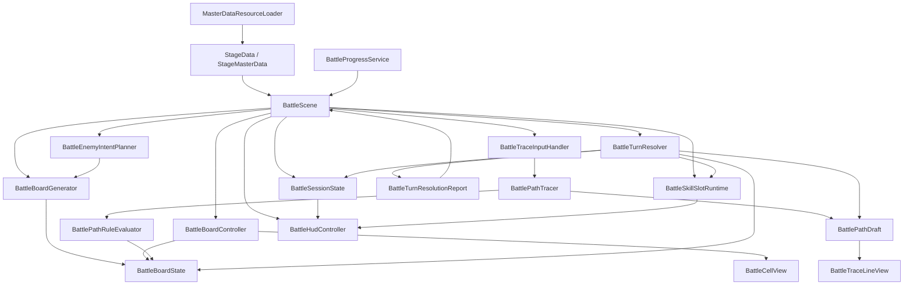

# 戦闘システム仕様書

- 最終更新: 2026-08-13
- 文書状態: 実装照合中
- 位置づけ: 本書は v1 を前提にしない。今後仕様と実装が衝突した場合は、原則として現行実装を優先して本書を更新する。

## 1. 企画の中核コンセプト

Path-Activation System v2 は、敵の攻撃を見ながら 1 ターンに 1 本の行動パスを組み立て、通過順に行動を解決する思考型ターン制バトルである。

面白さの中心は次の 3 点にある。

- そのターンでどのルートを取るかという攻め方の選択
- Jump / Roll をどこで使い、何を避けて何を受けるかという危険処理の選択
- 無傷では届かない局面で、被弾込みでも Goal に到達するかを決める不利受容の選択

v2 では Skill を盤面ノードではなく盤外 UI の Skill パレットから事前選択する方式に改める。Skill は主役の入力ではなく、そのターンの Attack ノードの価値を変える準備要素として扱う。

## 2. スコープと前提条件

### 2.1 戦闘人数

- 戦闘は 1 対 1
- 初期実装では敵は 1 体のみ

### 2.2 進行形式

- ターン制
- プレイヤーは 1 ターンに 1 本だけパスを引く
- 敵は 1 ターンに基本 1 アクションのみ行う

### 2.3 盤面サイズ

- 盤面サイズは `StageBattlePatternMasterData.Board` で定義する
- 現行の既定値は 5 列 x 6 行
- 開始マスの既定値は中央列の最下段

### 2.4 レイヤー構成

- 上部レイヤー: プレイヤー、敵、ダメージ演出、勝敗演出
- 下部レイヤー: グリッド、ノード、危険、Start、Goal

## 3. 盤面要素

### 3.1 標準ノード種別

v2 標準盤面では次を扱う。

- Start
- Goal
- Attack
- Jump
- Roll
- Dance
- 危険
- 空白マス

### 3.2 Skill の扱い

- v2 では Skill は標準盤面ノードとして配置しない
- Skill は盤外 UI の Skill パレットから事前選択する
- 選択中 Skill は、そのターン中に通過した Attack ノードすべてを Skill 行動に変換する
- 特殊盤面として Skill ノードを持つ拡張は将来候補に残すが、標準仕様には含めない

### 3.3 マスの重なり

- 1 マスには 1 要素のみ配置可能
- ノードと危険は重複しない
- Goal の上に危険は置かない

### 3.4 空白マス

- 単なる通路として通過可能
- 固有効果は持たない
- Jump / Roll の保持中でも通過可能

## 4. 盤面配置方針

### 4.1 基本方針

- 当面は固定配置
- ランダム生成は将来拡張

### 4.2 Start / Goal

- Start は毎ターン固定位置
- Goal は敵やステージに応じて位置が変わる
- Goal は複数存在可能
- 初期実装では 1 個から 2 個程度を基準とする

### 4.3 Goal 配置思想

- Goal は危険の先に置かれることが多い
- ただし毎回回避前提にはしない
- 安全寄り Goal と危険越え前提の高価値 Goal の両方を許容する

### 4.4 既定盤面の目安

- Attack: 3 から 5
- Jump: 1 から 2
- Roll: 1 から 2
- Dance: 0 から 1
- Skill ノード: 0
- Goal: 1 から 2
- 危険: 5 から 9
- 空白は一定数残し、常に最大密度にはしない

### 4.5 回避ノード最低保証

- 回避なしでは Goal 到達不可の盤面では Jump または Roll を最低 1 つ配置する
- 回避なしでも Goal に届く盤面では、回避ノードなしを許容する

## 5. パス入力ルール

### 5.1 接続方向

- 8 方向隣接で接続可能
- 上下左右に加えて斜め隣接マスへも接続できる

### 5.2 不正パス

以下は不正パスとする。

- 既に引いた線との交差
- 同じマスへの再訪
- Goal 到達後にさらに線を伸ばす行為

### 5.3 Goal の扱い

- Goal は終点専用マス
- パス途中の通過は不可
- Goal に触れた時点で確定可能状態に入る
- Goal 到達後に指が Goal から外れても確定可能状態は維持する
- 指を離した時点で確定する

### 5.4 Goal 未到達で指を離した場合

- 入力失敗
- パスは確定しない
- Start から引き直し可能
- 盤面は同ターン中変化しない
- 内部的には特殊敗北用の失敗累積対象になる

### 5.5 Skill 選択のタイミング

- Skill はパス開始前にのみ選択可能
- パス入力中は Skill を切り替えられない
- ドラッグ入力中は、パス入力以外の UI 操作を受け付けない
- 同ターン中の引き直しでは選択済み Skill 状態を維持する

## 6. スタックと解決ルール

### 6.1 仮スタック

- パス入力中、通過したノードや危険は仮スタックとして扱う
- Goal 確定前は未確定

### 6.2 確定条件

- Goal に到達し、指を離した時点で仮スタックが確定する
- Goal に到達できなかった場合は不発

### 6.3 解決順

- 通過順にそのまま順次解決する
- ダメージ計算、回避、被弾、補助効果は、各ノードや危険を解決するタイミングで都度即時反映する
- 敵攻撃による直接ダメージは、原則として危険マス接触時の `HazardHit` で発生する
- Goal 到達そのものを理由に敵攻撃 `EnemyAction` は発生させない
- 危険マス接触時は、回避または被弾 action の前に敵の攻撃演出用 `EnemyIntent` を解決列へ追加する
- 表示層では、`ResolvedActions` から演出 beat を作る。隣接する `JumpPrepared` / `RollPrepared`、`EnemyIntent`、`HazardEvaded` は 1 つの beat として扱い、敵側 `AttackStart` イベントを受けて回避アニメーションを開始する
- `EnemyIntent` と `HazardHit` は 1 つの beat として扱うが、プレイヤーの `Stun` は敵側 `Hit` イベントを受けて開始する
- 各アニメーションは `RecoverEnd` イベントを受けて終了扱いにする。イベントが無い、または未発火の場合はクリップ長や既存フォールバック秒数で進行する
- 表示層の演出 event は、関連する `BattleResolvedAction` と成立タイミングを持つ。HP ダメージや回復は原則として `Hit` event 到達時に反映し、被弾時の `HazardHit` は敵側 `Hit` を受けた `Stun` 開始時に反映する
- Skill の複数効果 action は、Skill 開始 action と効果 action に分けて演出 beat 化する。Skill 開始 action は Skill アニメーション開始時に成立通知し、最初の効果 action は Skill アニメーションの `Hit` event を受けて開始する
- 各 Skill 効果 action は `EffectAnimationData.CharacterAnimationName` が既存 `BattlePlayerAnimationCue` に対応する場合、そのキャラクター animation を再生する。対応 animation が無い場合は `EffectAnimationData.WaitSeconds` の待機だけで進行する
- Skill 効果 action のダメージ、回復、Guard、Charge、一時補正は、効果 animation の `Hit` event または `WaitSeconds` fallback に到達したタイミングで成立扱いにする
- `BattleTurnResultApplier` は、演出中に呼ばれる action 単位の即時反映と、ターン終了時の Skill 消費、ChargeGain、危険強化予約、一時補正、勝敗確定の後処理を分けて扱う

### 6.4 HP0 時の処理

- スタック解決中でもどちらかの HP が 0 になった時点で戦闘終了
- 後続スタックは解決しない

### 6.5 Skill 変換の反映タイミング

- そのターンに Skill を選択している場合、Attack ノード解決時に選択中 Skill へ変換する
- そのターン中に通過した Attack はすべて同じ Skill に変化する
- Attack を複数回通過した場合は同一 Skill が複数回解決される

## 7. 各要素の仕様

### 7.1 Attack

- 基本攻撃ノード
- Skill 未選択時は通常攻撃として解決する
- Attack を 2 回通過するとダブルアタック化する
- Jump 後の Attack はジャンプアタック化する
- Jump による通常危険回避を挟んでもジャンプアタックは成立する

設計上の基準値:

- 通常 Attack: 100
- ダブル Attack 追撃: 125
- Jump Attack: 150

Skill 選択中の扱い:

- Attack ノードは通常 Attack として解決しない
- 選択中 Skill の行動として解決する
- ダブルアタック化やジャンプアタック化より Skill 変換を優先する

### 7.2 Jump

- 通常危険を回避できる
- Attack をジャンプアタック化できる
- 攻め寄りの回避ノード

保持ルール:

- 空白マスのみを何マス挟んでも保持する
- 最初に接触した通常危険グループに対して回避成立
- 危険回避後でも Attack につながればジャンプアタック成立
- Attack、Dance、Roll、その他ノードを挟むと消失する
- Skill 選択中は Attack が Skill 化されるため、Jump の攻撃強化は発生しない

### 7.3 Roll

- 純粋な回避専用ノード
- 通常危険とスキル危険の両方に対応する
- 攻撃派生は持たない

保持ルール:

- 空白マスのみを何マス挟んでも保持する
- 最初に接触した対応危険グループに対して回避成立
- 別ノードを 1 つでも挟むと消失する

### 7.4 Dance

- 支援ノード
- 効果内容はアイテム装備に依存する

想定役割:

- 自己強化
- 回復
- 敵弱体
- その他支援効果

初期実装では盤面上の存在と将来拡張の窓口を先に定義し、詳細効果は後追いでもよい。

### 7.5 Skill

- Attack の上位互換ではなく別カテゴリの個別行動
- 内容や見た目は `BattleSkillMasterData` と `EffectAnimationMasterData` に依存する
- スキル効果は `BattleSkillOperationData` の配列として持つ
- 効果は配列順に上から実行する
- スキル全体の不発判定は持たず、各効果の `SuccessRate` で成功 / 失敗を扱う
- 全効果が失敗しても、消費条件を満たしたスキルは通常どおり消費する
- 初期実装対象の効果は `Damage`、`ChargeGain`、`Heal`、`GuardGain` とする
- 詳細な効果一覧、対象タイプ、値種別、参照パラメータは `docs/specs/スキル仕様書.md` を正とする

### 7.6 Skill パレット

- 各武器は最大 4 スロットの Skill パレットを持つ
- スロット状態は Ready、Charging、Locked、Empty を持つ
- 1 ターンに選択できる Skill は 1 種類のみ
- Skill はパス開始前に選択する
- Goal 未到達や不正パスで引き直す場合は選択済み状態を維持する
- 選択中 Skill は、パス入力確定時ではなく、確定パスの解決中に消費条件へ到達した時点で使用扱いになる
- 現行実装では、解決が Goal ノードまで到達し `PathConfirmed` が成立した場合に選択中 Skill を消費する
- 被弾停止、プレイヤー敗北、敵撃破などで Goal ノード解決前にスタックが終了した場合、選択中 Skill は消費しない
- Attack を 1 回も通らずに Goal まで解決された場合も、現行実装では選択中 Skill を消費する

### 7.7 装備候補スキルと実戦ロードアウト

- `EquipmentMasterData` は、その装備に紐づく候補スキルを最大 2 件まで持てる
- 候補スキルは `BattleSkillMasterData` として個別 ScriptableObject で管理する
- 候補スキルは「その装備が提供できるスキル一覧」であり、そのまま戦闘で使う 4 枠とは別概念とする
- 実際にバトルで使用できる Skill パレット 4 枠は、現在装備中の各装備が持つ候補スキル群から別途選抜して構成する
- 候補群の最大数は、装備中の対象装備数 x 2 件で決まる
- この「候補スキル」と「実戦ロードアウト 4 枠」は保存上も分けて扱える設計にする
- 現時点の実装では、この選抜ロジックや保存経路はまだ未実装であり、将来実装項目とする

### 7.8 Goal

- パスの終点
- 仮スタック確定トリガー
- 被弾せず最後まで解決が到達した場合のみ Goal 効果が有効

設計方針:

- 初期実装では単一 Goal 効果でよい
- Goal 固有補正より、到達難度と到達直前の状態差で価値差を作る
- 将来は Jump Goal、Dance Goal などの拡張を許容する

### 7.9 危険

- 危険は盤面上の特殊マス
- パス上を通行可能
- 通過時に被弾または回避判定が発生する

危険種別:

- 通常危険
- スキル危険

攻撃グループ:

- 危険は内部的に攻撃グループ識別子を持つ
- 同一グループの危険を複数マス踏んでも被弾判定は 1 回だけ
- Jump / Roll が成立した場合はそのグループ全体を回避扱いにする
- 危険解決では、演出用に `EnemyIntent` を先に記録し、その後に `HazardEvaded` または `HazardHit` を記録する
- 通常危険の `EnemyIntent` は敵 `Attack`、スキル危険の `EnemyIntent` は敵 `Skill` のアニメーション cue として扱う

被弾時:

- 被弾した危険の解決までは成立
- その後の未解決スタックは破棄
- Goal 効果も不発
- 被弾前に成立済みの効果は残る

## 8. 回避と被弾の詳細

### 8.1 回避成立条件

- Jump は通常危険のみ対応
- Roll は通常危険とスキル危険に対応
- どちらも空白マスは保持可能
- 別ノードを挟むと消失

### 8.2 被弾前提盤面

- 通常戦でも被弾前提でしか Goal に届かない盤面を許容する
- 回避を使えば被害を軽減できる盤面はある程度の頻度で出る前提とする
- 回避ノードを使っても被弾回避不可の盤面は、主に強敵、ボス、大技ターンの例外局面で許容する

## 9. 敵仕様

### 9.1 基本方針

- 敵の行動カテゴリはプレイヤーと同系統の概念を使う
- ただし内部処理は敵専用の簡略ルールでよい
- 敵は 1 ターンに基本 1 アクション
- 敵はプレイヤーの Skill パレット UI を使わない
- 敵行動のダメージ計算は、ノード解決の流れの中で行う

### 9.2 行動差別化

- 敵戦型
- 装備
- 行動傾向
- Skill 使用率
- Dance 使用率
- 危険配置パターン

### 9.3 敵戦型

- 各敵は 1 つの敵戦型を持つ
- 初期実装の敵戦型は `Guard型`、`Burst型`、`Rush型` の 3 種とする
- 敵戦型は、その敵がどう圧をかけ、どのような Break 成功条件や攻めどきを持つかを規定する
- 現行実装では、危険マス接触時に `EnemyIntent` を演出用 action として記録し、回避なら `HazardEvaded`、被弾なら `HazardHit` へ続ける
- Goal 到達後に敵行動を後付け解決しない。敵からの攻撃圧は、敵 intent に応じた盤面と危険マスで表現する
- 敵戦型は主に、危険地帯の量、危険グループの分かれ方、Break の有無、Break 後の隙の質を変える
- 基本解は `Attack` ノード通過数だけで成立する形を優先し、特定 Skill 系統の装備を前提条件にしない

### 9.4 Guard型

- 敵ゲージは純粋な Guard 値として扱う
- `Attack` ノード通過やそれに準ずる攻撃行動で Guard を削る
- Guard が `0` になると `Break` とする
- Guard型の `Break` は、`Burst型` のような 1 ターン完全無防備ではなく、装甲が剥がれて `軽装` 状態へ移行する意味で使う
- `軽装` 中は被ダメージが増える
- その代わり敵は身軽になり、次ターン以降の危険地帯は増える
- 初期実装では `軽装` は複数ターン継続する前提とし、具体ターン数は別途調整する
- `軽装` 終了後は通常状態へ戻り、再び Guard を持つ

### 9.5 Burst型

- 敵ゲージは大技までの進行度を表す
- ゲージは基本的にターン経過で進む
- これとは別に内部的な Break 判定値を持ち、`Attack` ノード通過やそれに準ずる攻撃行動で蓄積する
- Break 判定値が必要量に達した時点で `Break` とする
- Burst型の `Break` 成功時は、次の 1 ターンだけ敵が完全無防備になり、そのターンの危険地帯は `0` になる
- `Break` に間に合わなかった場合は、次ターンに高威力の回避困難な危険地帯を置く
- 初期実装では、ひび演出のような別レイヤーは持たず、ゲージ色の変化で Break 成功に近い状態を示す

### 9.6 Rush型

- 敵ゲージはそのターン中の攻勢残量を表す
- Rush ゲージは毎ターン開始時に最大値から始まる
- `Attack` ノード通過やそれに準ずる攻撃行動で Rush ゲージを減らす
- ターン終了時の残りゲージ段階に応じて、次ターンの危険地帯量を決める
- 残量が多いほど次ターンの危険地帯は多く、残量が少ないほど次ターンの危険地帯は少ない
- Rush型には `Break` 報酬を持たせない
- 問いの中心は「今ターンどこまで攻勢を削って次ターンの盤面を軽くするか」とする

### 9.7 敵タイプ

- ボス: 手作業設計
- 通常敵: タイプ分けで管理

### 9.8 初期実装で最初に作る通常敵

- バランス型
- 現在の実装では「敵が持つ pattern 候補からランダム選択」が先行実装
- 行動重みや行動選択ルールは将来実装とする

### 9.9 敵 Dance

- 主目的は次ターン危険強化
- 初期実装では危険強化 1 パターンのみでよい

### 9.10 敵 Skill

- 初期は広範囲攻撃系
- 広い範囲に危険を置く純粋攻撃

## 10. 装備とタグ

本章は戦闘システムから見た装備とタグの接点だけを扱う。
装備データの詳細は `docs/specs/装備仕様書.md`、タグ一致ボーナスの詳細は `docs/specs/タグ仕様書.md` を正とする。

属性相性の概念は採用しない。
攻撃属性、防御属性、属性相性テーブル、弱点、耐性、無効は新仕様では扱わない。

### 10.1 装備枠

- 頭装備
- 胴装備
- 右手装備
- 左手装備
- アイテム

左手装備は `Shield` と `SubItem` を持つ。
両者の違いは、属性相性ではなく、装備ごとの `BattleStatModifiers`、候補スキル、タグ一致ボーナスで表現する。

### 10.2 装備データ

- 装備データは戦闘用データと見た目 Sprite を兼用する。
- プレイヤーと敵は同じ `EquipmentMasterData` を参照できる。
- 全装備が `BattleStatModifiers` を持てる。
- 全装備が候補スキルを持てる。
- 候補スキルは 1 装備につき最大 2 件とする。
- 実戦用 Skill パレットは、装備が持つ候補スキル群から別途選抜して構成する。
- 装備は複数の `CategoryTags` を持てる。

### 10.3 BattleStatModifiers

`BattleStatModifiers` は装備から戦闘ステータスへ流し込む汎用補正である。
`Parameter` と `NamedValue` を対象にでき、`Set`、`Add`、`Multiply` を扱う。

`NamedValue` は `attack.normal.multiplier` のような文字列キーで参照する拡張値で、enum に固定する前の調整値や、ダメージ倍率などの補助値に使う。

旧 `Speed` は `BattleSkillParameterType.LegacySpeed = 4` として互換用に残す。
新仕様の戦闘計算では使用せず、スキル効果や装備補正で指定されても無視する。

### 10.4 タグ

- タグは、装備を横断してグループ化するためのキーワードである。
- タグは UI 分類、絞り込み、装備テーマ表示、タグ一致ボーナスに使う。
- タグは敵ごとの有利不利表としては使わない。
- タグの具体一覧はまだ固定しない。

タグ例:

- `軽装`
- `重装`
- `技巧`
- `舞踏`
- `突撃`

### 10.5 タグ一致ボーナス

アイテムを除く装備のタグが一定条件で揃った場合、ステータスにボーナス補正を加える。
`SubItem` は左手装備として対象に含め、除外するのは独立したアイテム枠のみとする。
現行実装では、`Helmet`、`Chest`、右手装備、左手装備をタグ一致判定の対象にする。

ボーナス内容は `BattleStatModifiers` 相当の追加補正として扱う。
初期の成立条件は、タグ一致判定対象の全装備が同じタグを持つ全一致とする。
初期補正値は、全一致タグ 1 件につき `Attack` へ `Multiply 1.10` を加える。
`BattleEquipmentDerivedDataResolver` は `CategoryTags` から 2 装備以上で一致したタグを `TagMatchCandidates` として出力し、全一致条件を満たしたものを `TagBonusMatches` として出力する。
成立済みタグ一致ボーナスは `TagBonusStatModifiers` として生成し、通常の `BattleStatModifiers` の後ろに追加して戦闘ステータスへ適用する。

### 10.6 表示方針

- 装備詳細ではタグを表示する。
- タグ一致ボーナスが成立している場合は、成立条件と効果を表示する。
- タグの内部補正キーや `NamedValue` は原則として UI に直接出さない。
- 属性相性ログや属性表示は初期 UI に出さない。

## 11. 持続効果

- 一時効果: そのターンのパス解決中だけ有効
- 持続効果: ターンをまたいで残る

初期実装では主にターン開始時とターン終了時だけ処理する。スタック途中で発動する持続効果は将来拡張とする。

## 12. 勝敗条件

### 12.1 基本勝敗

- 基本は HP0 による勝敗

### 12.2 特殊敗北

- Goal 到達失敗の累積による特殊敗北を持つ
- 意味づけはプレイヤーが隙を見せた状態

### 12.3 累積対象

- Goal まで届かず指を離した
- 不正パスで入力失敗した

以下は累積対象にしない。

- 被弾による Goal 効果不発
- HP ダメージによる通常敗北

### 12.4 表示方針

- 特殊敗北カウントは UI に出さない
- セリフや演出、説明文で匂わせる

## 13. UI 要件

画面構成、UI パーツ責務、表示位置、初期実装方針の詳細は `docs/specs/戦闘画面仕様書.md` を正とする。
本章では、戦闘システム側から必要な表示要件だけを要約する。

### 13.1 基本方針

- 戦闘画面は縦長 9:16 を初期前提にする
- 盤面グリッドを主操作として最優先する
- 情報は、できるだけその情報の持ち主の近くに置く
- 敵名、敵 HP、敵戦型は `EnemyUnitView` 側に置く
- プレイヤー HP は `PlayerAreaView` 側に置く
- Skill の Ready / Charging / Locked / Empty と選択状態は `SkillPaletteView` で伝える
- Turn / Wave / メニューなど、戦闘全体に 1 つだけ存在する固定情報のみ最上部 HUD に置く

### 13.2 必須表示情報

- Turn
- Wave
- 自分 HP
- 敵 HP
- 敵名
- 盤面要素一式
- Skill パレット
- 敵戦型ゲージ
- ダメージ量
- 敵 Dance 後の次ターン危険強化または危険強化発生通知
- 特殊敗北演出用の敵短文またはフレーバー

### 13.3 戦闘イベント通知

常設の確認・プレビュー文言と行動ログ履歴は、初期画面には置かない。
短命な技名、状態変化、Goal 到達、回避、被弾などは `BattleEventNoticeView` の一時表示として扱う。

表示例:

- Skill 名
- 回避
- 被弾
- Goal 到達
- 危険が増した
- 敵が体勢を変えた

### 13.4 入力中可視化

- 仮スタック一覧は出さない
- おすすめルートや推測は言わない
- 通過済みセル、現在セル、確定可能状態は盤面とパス線の見た目で伝える
- 不正入力は常設テキストではなく、赤表示、揺れ、トースト、バイブレーションなどで伝える
- 結果予測は常設の 1 行テキストではなく、ダメージ UI、HP 変化、Skill UI、盤面演出へ分担する

## 14. 1 ターンの基本フロー

1. ターン開始時効果を処理
2. 敵行動に応じた盤面、危険、Goal を表示
3. 必要に応じて Skill を事前選択
4. プレイヤーがパス入力
5. Goal 到達後、指を離して確定
6. `BattleTurnResolver` が `ResolvedActions` を通過順に生成する
7. 表示層が `ResolvedActions` から演出 beat を作り、プレイヤー / 敵のキャラクターアニメーションを再生する
8. HP、Skill、勝敗、次ターン予約などを結果として反映する
9. ターン終了時効果を処理
10. 次ターンへ移行

## 15. データとシーン遷移

### 15.1 戦闘用ステージデータ

現行方針では、戦闘用 master data は次の `ScriptableObject` 群で構成する。

- `StageMasterData`
  - `StageId`
  - `StageName`
  - `Description`
  - `BackgroundImage`
  - `PreviewImage`
  - `SortOrder`
  - `IsInitiallyUnlocked`
  - `EnemyRefs`
- `StageBattleEnemyMasterData`
  - `EnemyId`
  - `Name`
  - `MaxHp`
  - `Damage`
  - `BattleType`
  - `BattleTypeSettings`
  - `AppearanceSlots`
  - `AppearanceColors`
  - `Patterns`
- `StageBattlePatternMasterData`
  - `PatternId`
  - `Label`
  - `Description`
  - `EnemyAction`
  - `ConfirmText`
  - `DamageMultiplier`
  - `Board`
  - `CellPlacements`
- `EquipmentMasterData`
  - `EquipmentId`
  - `DisplayName`
  - `PartType`
  - `PartsIndex`
  - `Icon`
  - `SortOrder`
  - `IsDefaultOwned`
  - `AssignableSkills`
  - `BattleStatModifiers`
  - `CategoryTags`
- `BattleSkillMasterData`
  - `SkillId`
  - `SkillKey`
  - `DisplayName`
  - `Description`
  - `Icon`
  - `EffectData`
  - `EffectAnimation`
  - `RequiredCharge`
  - `StartingCharge`
  - `TurnChargeGain`
  - `AttackChargeGain`
- `BattleSkillOperationData`
  - `EffectType`
  - `TargetType`
  - `ParameterType`
  - `ValueType`
  - `Value`
  - `DamageFormula`
  - `DurationTurns`
  - `SuccessRate`
- `EffectAnimationMasterData`
  - `EffectAnimationId`
  - `EffectAnimationKey`
  - `DisplayName`
  - `Description`
  - `CharacterAnimationName`
  - `VisualEffectKey`
  - `SoundEffectKey`
  - `WaitSeconds`
補足:

- 作成側の参照は `Stage -> Enemy -> Pattern`、`Equipment -> Skill` の直接 `ScriptableObject` 参照で持つ
- `Database` asset は一覧と ID 逆引きの補助レイヤーとして扱う
- runtime DTO は ID リストではなく、解決済みの enemy / pattern / skill を受け取る
- 危険グループは編集データに持たず、runtime で上下左右連結から自動グループ化する
- 危険グループの連結方向は、パス接続方向の 8 方向とは別に扱う
- `BattleTypeSettings` は敵戦型ごとの設定値をまとめる serializable data とし、初期実装では別 `ScriptableObject` に分割しなくてよい

### 15.2 ステージ進捗データ

進捗側は以下を保持できる設計とする。

- StageId
- IsUnlocked
- IsCleared
- ClearCount
- BestScore
- BestRank
- BestClearTimeSeconds
- LastClearedAtUtc

### 15.3 遷移状態

- バトル開始時に選択ステージ ID を引き継ぐ
- 戦闘シーンはその ID を一度だけ消費して初期化に使う

### 15.4 現状の ID 整合性方針

- 論理上は 1 つのステージに 1 つの一意キーを持つ
- 現行コードでは `BattleSceneTransitionState`、`StageData`、`StageMasterData`、`BattleProgressService` のキーを数値 StageId に揃えた
- 実行時の「未選択」状態は `-1` を未設定値として扱う

## 16. 現状実装スナップショット

この節は 2026-05-09 時点の repo 実装を示す。ここは設計理想ではなく現物基準とする。

### 16.1 戦闘入口

- `HomeScreen` が `BattleSceneTransitionState.SelectedStageId` に数値 StageId を入れて `BattleScene` へ遷移する
- デバッグ時は Inspector の `debugBattleStageId` を使い、未指定時は `BattleProgressService.GetRecommendedStageId()` で補完する

### 16.2 ステージ読込

- `MasterDataResourceLoader.TryLoadStageData(int stageId, out StageData)` で `Resources/MasterData/StageDatabase` から読む
- `StageMasterDatabase` から `StageData` を生成する
- `StageMasterData.EnemyRefs` の先頭 1 体だけを現在の戦闘用敵として採用する
- enemy は `AppearanceSlots / AppearanceColors` と `Patterns` を持ち、loader が解決済み DTO に落とす
- `BattleScene` は `StageData.Enemy.Patterns` を現在ターンの供給源として消費する

### 16.3 現在のデモ戦闘パラメータ

- 初期プレイヤー HP: 450
- 通常 Attack: 100
- ダブル Attack 追撃: 125
- Jump Attack: 150

### 16.4 現在のデモ Skill スロット

- Slot 1: `Arc Flare`, Ready 閾値 3, 初期 1, 毎ターン +1, Attack x1.4 Damage
- Slot 2: `Pierce Volley`, Ready 閾値 5, 初期 2, 毎ターン +1, Attack x2.2 Damage
- Slot 3: Locked
- Slot 4: Empty

補足:

- `UserProfileData.SkillSlotSkillIds` が設定されている場合は、`BattleSkillMasterData` を引いて効果種別も runtime へ流す
- 現行では `UserProfileData.SkillLoadout.SkillIds` を実戦用 4 枠の正とし、`SkillSlotSkillIds` は互換フィールドとして同期する
- `SkillId` が未設定の旧 save は、暫定的にデモ名から sample skill へ補完する
- 装備ごとの候補スキルは最大 2 件として validation / tooltip / DTO 変換へ反映済みである
- 装備候補スキルから実戦用 4 枠を選ぶ保存/選抜導線は `BattleSkillLoadoutService` と `BattleSkillLoadoutPanel` で接続済みである
- 武器ごとの Skill パレット構成マスターは初期仕様では持たず、保存済みロードアウトだけを正とする
- `Mana Bloom` は Damage と ChargeGain の複数効果を持ち、`EffectData` の配列順に action 化される
- 現行戦闘解決では Damage、ChargeGain、Heal、GuardGain を初期 Skill 効果として処理する
- `ChargeGain` は選択中 Skill 自身へ、Skill 消費後に反映される
- `Heal` はプレイヤー HP を最大 HP まで回復する
- `GuardGain` は同一ターン内の一時 Guard として後続被ダメージを吸収する
- `Buff` / `Debuff` は Parameter 対象の一時補正として session に予約され、次ターン以降の `BattleTurnContext` 生成時に反映される
- 現行 Skill 効果データには `NamedValueKey` と明示的な operation がないため、Skill 由来の `NamedValue` 一時補正は未接続である
- `SuccessRate` は効果ごとに解決され、preview では安定表示、実行時は乱数判定する
- 失敗した効果は no-op action として記録し、後続効果は継続する

### 16.5 現在のデモ進行

現在は実グリッド入力ベースで、ターン内容は「敵が持つ `Patterns` から 1 件をランダム選択する」段階である。候補が複数ある場合は、直前と同一 pattern の連続選択を避ける。通常プレイでは、プレイヤーが実際に引いたパスを Goal 到達後に離して確定した場合だけターンを実行する。sample では以下の 6 pattern を持つ。

- Opening Attack
- Jump Evade
- Skill Showcase
- Enemy Dance Turn
- Roll Against Skill Hazard
- Hit Stops Remaining Stack

演出確認用に、`StageId=9001` の `Animation Timing Test` ステージを用意する。
このステージは `Roll Evade Enemy Attack Timing` pattern だけを持ち、`Start -> Roll -> 通常危険 -> Attack -> Goal` の縦ルートで、Roll 回避と敵 Attack の同時再生を確認できる。

現行コードは `Panels` を生成先 root として使い、既存 child を無効化した上で `BattleCellView` prefab を生成する。
ただし画面仕様上の最終形は、`BattleBoardView` が盤面領域、セル生成、セル更新、入力フィードバックを所有する形とする。
汎用 `Panels` に盤面セルだけを runtime 生成する構造は暫定実装として扱う。

- 盤面見た目は 5 列 x 6 行
- `Panels` の GridLayoutGroup は縦優先で子要素を並べる
- 開始マスは中央列の最下段に固定する
- 代替パスは pattern の配置セルをもとに実行時に構築できるが、通常プレイでは使わない
- 代替パス実行は `allowFallbackTurnExecution` を有効にした開発・検証用途に限定する

### 16.6 現在のターン解決・演出反映構成

- `BattleTurnResolver` は node type ごとの action class へ処理入口を分け、各 class が `BattleResolvedAction` を解決列へ追加する
- `BattleTurnResolutionState` はパス解決中の仮 HP、仮 Guard、勝敗、停止条件を管理する
- `BattleTurnAnimationPlanner` は `ResolvedActions` を演出 beat へ変換し、同時再生や `AttackStart` / `Hit` 待ちを含む成立タイミングを持たせる
- Skill は Skill 開始 beat と効果ごとの beat に展開される。複数効果は `EffectData` の配列順に順次再生され、`EffectAnimationData.CharacterAnimationName` と `WaitSeconds` を使って成立タイミングを作る
- `BattleTurnViewCoordinator` は演出再生中に成立した action を通知し、`BattleSceneController` がその場で HP、ダメージ表示、短命通知を更新する
- `BattleTurnResultApplier.ApplyFinalization` は、演出中に反映済みのダメージ/回復を再適用せず、ターン終了時だけ必要な Skill 消費、ChargeGain、危険強化予約、一時補正、勝敗確定を担当する

### 16.7 現在の危険強化

- 現行実装では、敵 Dance 後の危険強化は次ターンの危険ダメージ 1.5 倍として扱う
- ダメージ倍率の適用は Hazard 解決時に行う

### 16.8 現在の危険グループ

- 危険グループは master data に持たない
- `StageBattleRuntimeAdapter` が盤面生成後に、上下左右連結した危険マスへ同じ `HazardGroupId` を自動付与する
- 危険グループの上下左右連結は、パス接続の 8 方向化とは独立した現行仕様である
- 同一グループは被弾 1 回だけ、Jump / Roll による回避もグループ単位で処理する

### 16.9 現在の旧属性無効化状態

- `EquipmentMasterData` と `BattleSkillMasterData` には、既存 asset 保護用の旧属性 serialized field が残っている
- 装備の旧属性 field は runtime DTO へ変換しない
- スキルの旧属性 field は runtime DTO と `SkillSlotRuntime` へ変換しない
- `BattleEquipmentDerivedDataResolver` は旧属性を集約せず、`BattleStatModifiers`、`CategoryTags`、タグ一致候補、タグ一致ボーナス補正のみを集約する
- `BattleTurnContext` は攻撃属性、被ダメ属性補正を持たない
- `BattleDamagePipeline` は属性相性を参照せず、基礎ダメージをそのまま解決結果にする
- `AttributeSummary` は旧表示との互換受け口として残るが、新仕様では空文字のまま扱う
- 旧属性 field / asset の完全削除は、既存 serialized data の移行方針を決めてから行う

### 16.10 現在の UI 接続状態

- `previewImage` は反映される
- `background` はステージ背景として反映される
- `turnNumberText` と `waveNumberText` は更新される
- `playerHPText` は `現在HP/最大HP` で更新される
- Skill ボタンの選択色更新は実装済み
- `Panels` が見つかる場合は `BattleBoardController` と `BattleTraceInputHandler` を runtime で自動接続する
- 旧属性相性のプレビュー文言は出さない
- 常設の確認・プレビュー文言、行動ログ履歴は新しい戦闘画面仕様では初期画面に置かない
- 敵名、敵 HP、次ターン危険強化表示、敵戦型ゲージは未実装または未接続である

### 16.11 現在未接続のロジック

- 特殊敗北カウント
- 不正パス失敗と特殊敗北カウントの接続
- 勝利、敗北の本演出
- バトル結果の最終 save 接続
- `AttackChargeGain` の実消費
- 装備候補スキルから実戦用 4 枠を選ぶ保存/画面/接続
- 敵戦型 `Guard / Burst / Rush` の本実装
- 敵戦型ゲージ UI と `Burst` の色変化表示
- タグ / セットボーナスの表示 UI
- `EffectAnimationMasterData` を使った実エフェクト再生

## 17. 初期実装向け簡略化ルール

- 敵は 1 体のみ
- 盤面は固定またはスクリプト再生
- 敵戦型は `Guard型`、`Burst型`、`Rush型` の 3 種を優先する
- Skill は盤外パレット選択式
- 初期スキル効果は `Damage`、`ChargeGain`、`Heal`、`GuardGain` を中心にする
- 頭装備、左手装備の UI / 既存データ移行は別途実装する
- 状態異常は主役にしない
- 属性相性は採用しない
- 危険ターン演出は同系統で統一
- 持続効果は主にターン開始と終了時のみ処理

## 18. 将来拡張

- Goal 効果の本格拡張
- Dance Goal の持ち越し効果
- 頭装備
- 左手装備
- `Status` 系スキル効果
- スタック途中で発動する持続効果
- `BoardManipulation` / `HazardControl` 系スキル効果
- `ExtraAction` 系スキル効果
- Skill ノードを使う特殊盤面
- ランダム生成盤面
- 複数敵

## 19. 具体値が未確定の項目

以下は設計意図はあるが、まだ最終値が固定されていない。

- プレイヤー Skill の正式性能
- 敵 Skill の正式性能
- Skill 効果ごとの正式な `SuccessRate`
- `SuccessRate` 補正に使うタグ、状態、盤面結果、敵行動などの具体値とデータ入力元
- Skill 由来の `NamedValue` 一時補正を指定するための key / operation データ構造
- Skill 準備値の加算量
- Skill Ready に必要な閾値
- Skill 使用後のゲージ初期値
- `Guard型` の Guard 最大値と `軽装` 継続ターン数
- `Burst型` の大技進行速度と Break 必要量
- `Rush型` の残量段階ごとの危険地帯量
- Skill スロット解放条件
- 特殊敗北演出の具体内容
- タグ一致ボーナスの成立条件と具体補正値
- 敵 AI の重みテーブル詳細

## 20. リファクタ後の実装構成案

### 20.1 基本方針

- `BattleScene` はシーン司令塔に縮退し、盤面状態、入力判定、解決ロジック、HUD 更新を直接抱え込まない
- pure C# の戦闘コアと `MonoBehaviour` の表示層を分離する
- 旧デモ実装には依存せず、`StageData.Enemy.Patterns` を本番盤面の正本とする
- `グリッドパズルゲーム.txt` の責務分離思想は採用するが、`match-3` 前提の概念名は持ち込まない

### 20.2 クラス一覧と配置パス

初回リファクタで追加または改名対象とするクラスは以下とする。

| レイヤー | クラス名 | 配置パス | 役割 |
| --- | --- | --- | --- |
| Scene | `BattleScene` | `Assets/Scripts/Features/Battle/Demo/BattleScene.cs` | 当面は既存ファイルを維持し、初期化、ターン開始、結果反映、進捗保存、各コントローラ仲介のみを担当する |
| Core | `BattleGridPosition` | `Assets/Scripts/Features/Battle/Core/BattleGridPosition.cs` | 盤面座標。`x`,`y` と隣接判定、等価比較を持つ値オブジェクト |
| Core | `BattleNodeType` | `Assets/Scripts/Features/Battle/Core/BattleNodeType.cs` | `Start`,`Empty`,`Jump`,`Roll`,`Dance`,`Attack`,`HazardNormal`,`HazardSkill`,`Goal` を持つ本番 enum |
| Core | `BattleEnemyActionType` | `Assets/Scripts/Features/Battle/Core/BattleEnemyActionType.cs` | 敵のターン行動種別。`NormalAttack`,`Skill`,`Dance` を持つ本番 enum |
| Core | `BattlePathValidationError` | `Assets/Scripts/Features/Battle/Core/BattlePathValidationError.cs` | `NotAdjacent`,`Revisit`,`CrossedSegment`,`ExtendedAfterGoal`,`OutOfBounds` などの不正理由を表す |
| Runtime | `BattleCellState` | `Assets/Scripts/Features/Battle/Runtime/BattleCellState.cs` | 1 マスぶんの状態。座標、`BattleNodeType`、危険グループ ID、表示用補助フラグを持つ |
| Runtime | `BattleBoardState` | `Assets/Scripts/Features/Battle/Runtime/BattleBoardState.cs` | 可変サイズ盤面全体。サイズ、セル配列、`Start`、`Goal` 一覧、検索 API を持つ |
| Runtime | `BattlePathDraft` | `Assets/Scripts/Features/Battle/Runtime/BattlePathDraft.cs` | 入力中の仮パス。通過座標列、到達済み `Goal`、確定可能状態、最後の線分集合を持つ |
| Runtime | `BattleSkillSlotRuntime` | `Assets/Scripts/Features/Battle/Runtime/BattleSkillSlotRuntime.cs` | Ready、Charge、消費、表示ラベルを持つ戦闘スキル枠ランタイム |
| Runtime | `BattleSessionState` | `Assets/Scripts/Features/Battle/Runtime/BattleSessionState.cs` | プレイヤー HP、敵 HP、ターン数、Wave、選択 Skill、次ターン危険強化、特殊敗北カウントなどの戦闘進行状態 |
| Runtime | `BattleTurnContext` | `Assets/Scripts/Features/Battle/Runtime/BattleTurnContext.cs` | 1 ターン解決に必要な固定値。攻撃力、敵行動種別、危険強化状態、選択 Skill を束ねる |
| Runtime | `BattleTurnResolutionReport` | `Assets/Scripts/Features/Battle/Runtime/BattleTurnResolutionReport.cs` | 解決結果。確定可否、与ダメ、被ダメ、Goal 成否、Skill 消費、表示用イベント、終了フラグを返す |
| Logic | `BattlePathRuleEvaluator` | `Assets/Scripts/Features/Battle/Logic/BattlePathRuleEvaluator.cs` | 8 方向接続、再訪禁止、線分交差禁止、Goal 後延長禁止を判定する pure C# ルール評価器 |
| Logic | `BattlePathTracer` | `Assets/Scripts/Features/Battle/Logic/BattlePathTracer.cs` | ドラッグ中の入力を `BattlePathDraft` に反映する。前のマスへの戻り Undo と `Goal` 到達状態維持を担当する |
| Logic | `BattleTurnResolver` | `Assets/Scripts/Features/Battle/Logic/BattleTurnResolver.cs` | 確定パスを通過順に解決し、攻撃、Skill 変換、回避、被弾、Goal 不発を `BattleTurnResolutionReport` にまとめる |
| Logic | `BattleBoardGenerator` | `Assets/Scripts/Features/Battle/Logic/BattleBoardGenerator.cs` | ステージ定義と敵行動からターン盤面を生成する。固定テンプレート利用もここに寄せる |
| Logic | `BattleEnemyIntentPlanner` | `Assets/Scripts/Features/Battle/Logic/BattleEnemyIntentPlanner.cs` | 敵 AI または暫定重みから、そのターンの `NormalAttack` / `Skill` / `Dance` を決める |
| Presentation | `BattleTurnAnimationPlanner` | `Assets/Scripts/Features/Battle/ViewControllers/BattleTurnAnimationPlanner.cs` | `ResolvedActions` を演出 beat に変換し、回避と敵攻撃の同時開始、被弾 `Stun` の着弾遅延を決める |
| Presentation | `BattleBoardController` | `Assets/Scripts/Features/Battle/Presentation/BattleBoardController.cs` | `BattleBoardState` をグリッド表示へ反映し、セル View の生成と更新を担当する `MonoBehaviour` |
| Presentation | `BattleCellView` | `Assets/Scripts/Features/Battle/Presentation/BattleCellView.cs` | 単一セルの見た目とヒット判定を担当する `MonoBehaviour` |
| Presentation | `BattleTraceLineView` | `Assets/Scripts/Features/Battle/Presentation/BattleTraceLineView.cs` | ドラッグ中の線、確定可能状態、交差不可フィードバックを描画する `MonoBehaviour` |
| Presentation | `BattleTraceInputHandler` | `Assets/Scripts/Features/Battle/Presentation/BattleTraceInputHandler.cs` | Pointer 入力を `BattlePathTracer` に流し、確定イベントを `BattleScene` へ通知する `MonoBehaviour` |
| Presentation | `BattleHudController` | `Assets/Scripts/Features/Battle/Presentation/BattleHudController.cs` | 当面の統合 HUD。最終的には `BattleTopHudView`、`EnemyUnitView`、`PlayerAreaView`、`SkillPaletteView`、`BattleEventNoticeView` へ責務分割する |

補足:

- 初回リファクタでは scene や prefab の GUID 変更を避けるため、`BattleScene` 自体は現パスに残してよい

### 20.3 依存ルール

- `Presentation` は `Logic` と `Runtime` を参照してよい
- `Logic` は `Runtime` と `Core` のみを参照し、`UnityEngine` に依存しない
- `Runtime` は `Core` のみを参照し、`MonoBehaviour` を持たない
- `Data` 層の `StageData` と `MasterDataResourceLoader` は `BattleScene` または `BattleBoardGenerator` から読み出し、セル View からは直接参照しない
- 旧デモ専用データは持たず、本番フローは `StageData.Enemy.Patterns` を直接使う

### 20.4 既存 `BattleScene` からの責務移管

現在の `BattleScene` の責務は、以下のように分割する。

| 現在 `BattleScene` にある責務 | 移管先 |
| --- | --- |
| ステージ ID 解決、進捗反映、シーン初期化 | `BattleScene` のまま維持 |
| ステージ見た目反映 | `BattlePresentationView` と `BattleBoardView` |
| Skill ボタン選択と見た目更新 | `SkillPaletteView` と `BattleSkillSlotRuntime` |
| Pattern 候補の選択と盤面供給 | `StageData.Enemy.Patterns` を読み、将来的には `BattleEnemyIntentPlanner` と `BattleBoardGenerator` へ整理する |
| `BattleDemoPathResolver.Resolve(...)` の呼び出し | `BattleTurnResolver.Resolve(...)` |
| Goal 到達判定と `PathConfirmed` 分岐 | `BattlePathTracer` と `BattleTurnResolver` |
| 危険強化フラグ管理 | `BattleSessionState` |
| HP 更新、勝敗更新、次ステージ解放 | `BattleScene` が `BattleTurnResolutionReport` を受けて反映する |

### 20.5 依存関係図

### 20.6 導入順

- 第 1 段階: `BattleNodeType`、`BattleSkillSlotRuntime`、`BattleTurnResolver` を追加し、旧デモ名称から切り離す
- 第 2 段階: `BattleBoardState`、`BattlePathDraft`、`BattlePathRuleEvaluator`、`BattlePathTracer` を追加して実ドラッグ入力へ置き換える
- 第 3 段階: `BattleBoardController`、`BattleCellView`、`BattleTraceLineView`、`BattleHudController` を追加して `BattleScene` の UI 責務を外へ出す
- 第 4 段階: `BattleEnemyIntentPlanner` と `BattleBoardGenerator` を追加し、pattern 選択と盤面生成を整理する

## 21. オミットされた項目

仕様を現行実装へ寄せる際に削除または置換した旧記述は、この節へ移す。
各項目にはオミットした日付を記録する。

### 2026-08-13

- 旧記述: `Goal 到達後かつ盤面上の Hazard 解決が無かった場合に敵行動 EnemyAction を直接ダメージとして解決する`
  - 理由: ゴール成功時に敵攻撃が入る挙動は現行の戦闘仕様から外れるため。敵攻撃は危険マス接触時の `EnemyIntent` と `HazardHit` / `HazardEvaded` で表現する。
- 旧記述: `被弾時も敵の攻撃とプレイヤーの被弾を同時に見せる`
  - 理由: 敵攻撃の着弾前にプレイヤー `Stun` が始まると解決順が読みにくいため。`EnemyIntent` と `HazardHit` は同じ beat にまとめるが、`Stun` は敵側 `Hit` イベントを受けて開始する。

### 2026-07-04

- 旧記述: `Skill 選択状態でパスが確定した時点でその Skill は使用扱いになる`
  - 理由: 現行実装では入力確定時ではなく、解決が Goal ノードまで到達して `PathConfirmed` が成立した場合に消費するため。
- 旧記述: `Attack を 1 回も通らず不発でも、そのターンの選択は消費する`
  - 理由: 「不発」の扱いを廃止し、現行実装どおり Goal ノード解決まで到達したかどうかを Skill 消費条件とするため。
- 旧記述: `直接ダメージは、原則としてプレイヤーが危険地帯に乗ったタイミングでのみ発生する`
  - 当時の理由: 2026-07-04 時点の実装では、危険マス接触時の `HazardHit` と、Goal 到達後かつ盤面上の Hazard 解決が無かった場合の `EnemyAction` の両方で敵側ダメージを解決していたため。
  - 2026-08-13 更新: この旧記述を再び現行仕様として採用し、Goal 到達後の `EnemyAction` は発生させない。
- 旧記述: `BattleScene の現行 scene 上では、Panels 配下の既存 UI ノード群を盤面セルとして再利用している`
  - 理由: 画面表示方式は未定とし、既存 UI ノード再利用方式と prefab 生成方式のどちらへ寄せるかを今後決めるため。
- 旧記述: `設計書では危険マス数 1.5 倍を想定している`
  - 理由: 現行仕様では、実装どおり次ターンの危険ダメージ 1.5 倍を正とするため。
